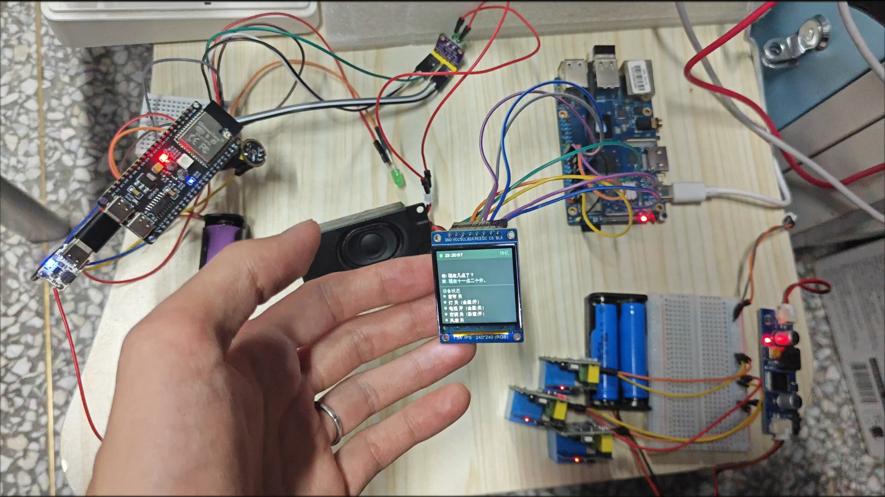

# Xiaochen · Fully Offline Home Voice Assistant

[简体中文](README.md) | **English**

> ESP32-S3 on-device wake word + Orange Pi edge brain (ASR / two-tier decision / Qwen3-0.6B / TTS) + ESP8266 relay actuators — a wake → recognize → decide → execute → speak loop closed in seconds between device and edge, running entirely on the LAN with no cloud dependency.
>
> 🎬 Demo video [bilibili](https://b23.tv/lUWWbtx) · 📦 Large model files [Releases](https://github.com/HBConline/xiaochen-voice/releases) · 🐳 Image [`ghcr.io/hbconline/xiaochen-voice-server`](https://github.com/users/HBConline/packages/container/package/xiaochen-voice-server) · 🛒 BOM [`docs/BOM.md`](docs/BOM.md) · 🔌 Wiring [`docs/WIRING.md`](docs/WIRING.md)

<p align="center">
  <a href="https://b23.tv/lUWWbtx"></a>
</p>

A self-built device–edge collaborative voice assistant. The audio node runs wake-word detection around the clock; say "Xiaochen" (小宸同学) to start a conversation. Speech recognition, intent understanding, LLM decision-making and speech synthesis all happen locally on an Orange Pi 4 Pro. Recognized commands drive relays over MQTT to control lights, curtains, fans and other appliances, and the spoken reply is streamed back to the node for playback. The project covers the full on-device model deployment chain: dataset building → model training → quantized conversion → deployment → real-device iteration.

---

## Contents

- [Features](#features)
- [System Architecture](#system-architecture)
- [Hardware](#hardware)
- [Tech Stack](#tech-stack)
- [How It Works](#how-it-works)
- [Repository Layout](#repository-layout)
- [Quick Start](#quick-start)
- [Testing](#testing)
- [Design Decisions & Pitfalls](#design-decisions--pitfalls)
- [Model Files](#model-files)
- [Roadmap](#roadmap)
- [FAQ](#faq)

---

## Features

- **Offline wake word**: custom wake word "Xiaochen", microWakeWord mixednet quantized to int8, TFLite Micro streaming inference resident on the ESP32-S3 — works even with no internet
- **Voice-controlled appliances**: lights (living room / bedroom), curtain (living room), fan (bedroom); device bindings are room-isolated, so "open the curtain" never moves another room's curtain
- **Two-tier decision**: simple commands hit micro-rules directly (millisecond, zero inference cost); complex requests are parsed by the Qwen3-0.6B LLM, which calls standardized tools over the MCP protocol
- **Natural conversation**: prompt engineering defines the persona (Xiaochen), dialogue policy and tool-call conventions; chit-chat gets full LLM long-form replies
- **Voice playback**: Matcha TTS streaming synthesis; audio chunks are pushed back to the node over MQTT and played while still streaming
- **Network autonomy**: the Orange Pi hosts its own WiFi AP, every device gets a fixed IP bound to its MAC, the whole system keeps running without internet
- **Visual feedback**: an ST7789 color display on the node shows dialogue state (optional)
- **Engineering quality**: 6 automated test suites (98/98 intent rules, device layer, MCP, voice state machine); OTA updates with byte-level firmware verification

## System Architecture

```
┌─────────────────┐        ┌──────────────────────────────────────┐        ┌─────────────────┐
│  ESP32-S3 node   │  WiFi  │        Orange Pi 4 Pro (CPU only)     │  MQTT  │  ESP8266 ×N     │
│  xiaochen-node1 │        │              192.168.4.1               │        │  Tasmota relays │
│                 │ audio  │                                      │commands│                 │
│ microWakeWord   │ ─────> │  ① SenseVoice ASR (int8)              │ ─────> │ relay1  LR lamp │
│  always-on wake │        │  ② Silero VAD (utterance split)       │        │ relay2  BR lamp │
│ I2S microphone  │ <───── │  ③ two-tier decision                  │ <───── │ curtain1 LR cur.│
│ speaker (TTS)   │  TTS   │     ├ micro-rules → direct commands    │ status │ fan1    BR fan  │
│ ST7789 display  │ stream │     └ Qwen3-0.6B → MCP tool calls      │        │                 │
│ FreeRTOS tasks  │        │  ④ Matcha TTS (int8)                  │        └─────────────────┘
└─────────────────┘        │  ⑤ MQTT broker / Flask audio API       │
                            │  ⑥ hostapd AP + dnsmasq MAC-fixed IPs │
                            └──────────────────────────────────────┘
```

### Data flow of one full interaction

1. **Wake**: microWakeWord on the node analyzes mic frames continuously; the sum of wake probabilities over the sliding window (30 frames) crosses the threshold (cutoff = 0.07)
2. **Local ack**: the "I'm listening" prompt plays immediately (no server round-trip, perceived zero latency) and recording starts
3. **End-of-speech**: onset gating — the silence countdown starts only after speech is detected; if nobody speaks within 2.5 s the session resets (so false wakes don't block the channel)
4. **Upload**: recordings shorter than 0.3 s are dropped (filters false-wake noise); PCM 16 kHz/S16LE is POSTed to the Flask audio API
5. **Recognize**: SenseVoice ASR (int8) transcribes; Silero VAD helps split utterances
6. **Decide**:
   - Simple device command ("turn on the living room light") → micro-rule match → device command generated directly, **zero inference cost**
   - Complex request ("make the house a bit brighter") → Qwen3-0.6B (Q4_K_M, llama.cpp CPU inference) parses it and picks device/system tools from the whitelist via MCP to build commands
   - Pure chit-chat → the LLM generates the reply text directly
7. **Execute**: device commands are published over MQTT to the Tasmota relays (`cmnd/<topic>/POWER`); device state is written back
8. **Speak**: the reply text is synthesized by Matcha TTS and pushed back to the node via the MQTT begin/chunk/end three-phase protocol
9. **Display**: dialogue text shows on the ST7789 screen (optional)

## Hardware

> Shopping list, reference prices and gotchas in [`docs/BOM.md`](docs/BOM.md); wiring diagrams in [`docs/WIRING.md`](docs/WIRING.md).

| Hardware | Role | Key specs | Qty |
|------|------|---------|------|
| ESP32-S3 dev board | Audio node | dual-core LX7 240 MHz, 512 KB SRAM, I2S, WiFi | 1 |
| Orange Pi 4 Pro | Edge brain | 8-core ARM, 4 GB RAM, CPU only (no GPU), Ubuntu 22.04 | 1 |
| ESP-01 (ESP8266) + relay board | Appliance actuator | single-core 80 MHz, GPIO0 drives relay, Tasmota-lite 14.6 | 4 |
| INMP441 I2S digital mic (node) | Capture | 16 kHz / S16LE / mono | 1 |
| Speaker + MAX98357 I2S amp (node) | Playback | I2S output | 1 |
| ST7789 1.54" color display | Dialogue display (optional) | 240×240 SPI | 1 |
| CH340 USB-TTL | Flashing / serial config | 3.3 V! 5 V burns the module | 1 |

## Tech Stack

| Layer | Technology | Purpose |
|----|------|------|
| Device hardware | ESP32-S3 / ESP8266, ESP-IDF, FreeRTOS | Audio node firmware (multitasked real-time audio), relay actuators |
| Device build | ESPHome, PlatformIO, C++ | Declarative YAML config + custom audio/wake components + build & flash |
| Wake model | microWakeWord, TensorFlow, TFLite Micro | Mixednet trained from scratch, PTQ int8, resident streaming inference on MCU |
| Speech runtime | Sherpa-ONNX (SenseVoice ASR / Silero VAD / Matcha TTS) | int8-quantized recognition, utterance split, synthesis — all local |
| LLM | Qwen3-0.6B, llama.cpp, GGUF Q4_K_M | Long-tail request parsing, chit-chat replies, CPU inference |
| Tool calling | Prompt engineering, MCP | Persona & call conventions; device capabilities exposed as standardized tools |
| Messaging | MQTT, HTTP (Flask) | Command dispatch / state reporting / TTS streaming; audio upload API |
| Networking | hostapd, dnsmasq | Self-hosted WiFi AP, MAC-bound fixed IPs |
| Operations | Linux, systemd, Python | Service deployment, test suites, config scripts |
| Device firmware | Tasmota 14.6 lite | Battle-tested ESP-01 relay firmware with MQTT |

## How It Works

### On-device wake word: microWakeWord mixednet

- **Model**: mixednet (time-domain + frequency-domain convolution hybrid), tiny (hundreds of KB), designed for MCUs
- **Decision**: every frame of audio features yields a wake probability; the sum over the last N frames (sliding window = 30) exceeding `cutoff × window` triggers the wake. cutoff is the false-reject / false-accept trade-off knob (calibrated to 0.07 here)
- **Training**: real human voice positives + background noise and near-miss hard negatives ("Xiaoming", "Xiaozhang", "hello classmates"), trained from scratch in TensorFlow (rounds r5–r9), exported to tflite with PTQ int8
- **Key pitfall**: a model trained on synthetic (TTS) speech only wakes to that TTS voice — zero wake for real humans. Domain overfitting. The fix: rebuild the training set from real human voice and A/B-validate; the real device is the only judge

### Quantization: why int8 / Q4

| Scheme | What it does | Used for |
|------|------|--------|
| PTQ int8 | Post-training quantization, `q = round(x / scale)`, 4× smaller | Wake model, ASR/TTS/VAD |
| Q4_K_M | GGUF 4-bit block quantization (k-quant) | Qwen3-0.6B (380 MB, fits resident on a 4 GB board) |

Without quantization, an fp32 wake model won't run on an MCU and a 7B-class LLM won't even fit in RAM. Quantization is what makes "multiple resident models on a small CPU-only board" possible.

### Two-tier decision: rules as the floor, model as the extension

- **Micro-rule layer**: text normalization (norm) → pattern matching → device commands. Millisecond latency, 100% deterministic, covers high-frequency commands like lights/curtain/fan
- **LLM layer**: Qwen3-0.6B parses complex/long-tail requests; prompt engineering pins the output format (JSON tool calls); tools are invoked over MCP (arguments pass whitelist validation before touching hardware); parse failures degrade to a clarifying question
- **Why tiered**: routing everything through the LLM is slow and non-deterministic, and high-frequency switches need millisecond certainty; pure rules can't cover the long tail. Rules as the floor, model as the extension is the optimal split under tight resources

### MCP: standardized device capabilities

Device and system capabilities (turn on light, close curtain, query state) are wrapped as MCP tools (schemas define inputs/outputs). Benefits:

1. Tool definitions decouple from the model — swap models without touching the tool layer
2. Tools are reusable across clients — voice, web and other agents share the same tool set
3. A new device just registers a new tool; zero changes to LLM code

### Two recording details (the engineering is in the details)

- **Onset gating**: the end-of-speech silence countdown starts only once speech is detected, tolerating the pause after the wake word (otherwise 0.8 s of silence cuts the utterance — symptom: "woke up but no response")
- **Fast reset**: if no speech within 2.5 s, give up and reset — a false wake yields the channel quickly instead of crowding out a real one

### Network autonomy: SoftAP

A phone hotspot's DHCP subnet drifts (124.x → 207.x), turning every hard-coded IP in firmware into a brick. The root fix: the Orange Pi hosts its own AP via hostapd (`xiaochen-ai`) + dnsmasq binds fixed IPs per MAC, so every device address is permanently stable and the system works with no internet. Deployment kit in `deploy/softap/`.

## Repository Layout

```
xiaochen-voice/
├── README.md / README-EN.md      # this file (English) / Chinese version
├── firmware/                     # ESP32-S3 node firmware
│   ├── xiaochen-node1.yaml       # ESPHome main config (WiFi/MQTT/microWakeWord/I2S/display)
│   ├── secrets.yaml.example      # WiFi credentials template (cp to secrets.yaml; never committed)
│   ├── xiaochen.json             # wake model description (cutoff 0.07, window 30, tensor arena 120KB)
│   ├── xiaochen.tflite           # wake model (int8, ~75KB, r9a real-voice trained)
│   ├── node_audio.h              # audio core: wake task, onset-gated recording, HTTP upload, TTS playback
│   ├── node_play.h               # playback (prompt sounds / TTS stream)
│   ├── wozai_pcm.h               # "I'm listening" prompt PCM data
│   ├── micro_wake_word.cpp.mwwprobe  # patched microWakeWord component (probability logging etc.)
│   ├── build_node1.sh            # build script (esphome codegen → patch copy → pio run)
│   ├── do_ota.py                 # OTA push (esphome.espota2, port 3232)
│   ├── mqpub.py / mqplay.py      # PC-side MQTT debug tools
│   ├── mqtt_push_tts.py          # TTS audio chunk pusher
│   ├── sshop.py                  # run commands on the Orange Pi over SSH (password via OP_PASS env)
│   ├── t9890.py / read_logs.py   # debug helpers
│   └── mic-debug.yaml / test-*.yaml / xiaochen-debug.json  # debug configs
├── server/                       # Orange Pi server (Python)
│   ├── app/
│   │   ├── wakeword_server.py    # service entry: audio API, mic capture loop, pipeline orchestration
│   │   ├── intent.py             # intent entry: text → two-tier decision
│   │   ├── microrules.py         # B3 micro-rule engine (98 rule tests green)
│   │   ├── norm.py               # text normalization
│   │   ├── voice_brain.py        # Qwen3-0.6B brain (llama.cpp client, prompt engineering, tool calls)
│   │   ├── mcp_pool.py           # MCP tool pool scheduling
│   │   ├── servers/home_mcp.py   # MCP server: device & system capabilities → standardized tools
│   │   ├── device_layer.py       # device layer: room bindings, state machine, MQTT relay backend
│   │   ├── mqtt_bridge.py        # MQTT bridge (begin/chunk/end TTS streaming etc.)
│   │   ├── tts.py                # Matcha TTS synthesis
│   │   ├── scenes.py             # scene modes (homecoming mode etc.)
│   │   ├── session.py / voice_state.py / dialogue_view.py  # session, state machine, dialogue view
│   │   ├── st7789_display.py     # display service
│   │   ├── home_config.py / gen_dataset.py                 # config, data generation
│   │   ├── static/               # web debug pages (index/play/realtime/wakeword)
│   │   └── test_*.py             # test suites ×8
│   ├── scripts/                  # startup scripts for the board
│   │   ├── start_llama.sh        # llama-server (Qwen3-0.6B brain, -c 2048 --parallel 1)
│   │   └── start_server.sh       # voice pipeline (exports BRAIN_URL / TTS_THREADS etc.)
│   ├── Dockerfile                # voice pipeline image (GHCR: xiaochen-voice-server)
│   ├── docker-compose.yml        # brain + voice dual service (model bind-mounts, host network)
│   ├── requirements.txt          # server Python dependencies
│   ├── build-push.sh             # arm64 build & push to GHCR
│   └── deploy/
│       ├── chenvoice-*.service   # systemd units (brain / voice / display)
│       └── softap/               # ★ network-autonomy deployment kit
│           ├── hostapd.conf      # AP config (SSID xiaochen-ai, password placeholder)
│           ├── dnsmasq.conf      # DHCP + MAC fixed IPs (.10/.21/.22/.23/.24)
│           └── setup-softap.sh   # one-shot installer (password via AP_PASS env)
├── training/                     # wake word training (collected from D:/mww)
│   ├── gen_pos_v2.py / gen_neg_v2.py / gen_neg_zh.py       # positive/negative sample generation
│   ├── gen_neg_nearmiss.py / process_nearmiss.py           # hard negatives (near-miss words)
│   ├── cut_real_pos.py / segment_v2.py / split_*.py        # real-voice segmentation & dataset building
│   ├── build_features.py         # feature building
│   ├── conv_tflite.py            # int8 TFLite export (stateless fix)
│   ├── score_ab.py               # A/B scoring (real-device validation)
│   ├── replay_wake.py / test_distractors.py                # wake replay / distractor tests
│   └── reapply_mww_patch.py      # microWakeWord patch reapply
├── tools/                        # ESP-01 / relay tools
│   ├── cfg_relay2.py             # one-shot Tasmota serial config (WiFi/MQTT/template; passwords masked)
│   ├── listen_serial.py          # serial monitor
│   ├── scan_fan.py               # subnet scan by MAC
│   ├── patch_curtain_binding.py  # device-level binding patch for device_layer
│   └── test_curtain_relay.py     # curtain binding regression (11 cases)
└── docs/
    ├── softap-cutover.md         # ★ SoftAP cutover checklist (migration/verify/rollback)
    ├── WIRING.md                 # ★ wiring diagrams (node audio / ST7789 / ESP-01 flash & relay)
    ├── BOM.md                    # shopping list (reference prices & gotchas)
    ├── HANDOFF-ORANGEPI.md       # Orange Pi deployment handoff
    └── MWW-TRAINING-GUIDE.md     # wake word training guide
```

## Quick Start

### Requirements

- Orange Pi 4 Pro (Ubuntu 22.04 aarch64, Python 3.10, CPU only)
- PC: Python 3.10+, PlatformIO, esphome (to build firmware)
- conda env `mww` (wake word training, TensorFlow)

### 1. Server deployment (Orange Pi)

```bash
# sync server/ to the board (contents land at ~/chenvoice/ root, matching systemd unit paths)
ssh orangepi@<board-ip> 'mkdir -p ~/chenvoice'
scp -r server/* orangepi@<board-ip>:~/chenvoice/

# server dependencies
pip install -r ~/chenvoice/requirements.txt

# place models (not in this repo — see "Model Files")
#   ~/chenvoice/brain/Qwen3-0.6B-xiaochen-Q4_K_M.gguf
#   Sherpa-ONNX ASR/TTS/VAD int8 model directories

# start (llama.cpp first, then the service)
bash ~/chenvoice/scripts/start_llama.sh      # -c 2048 --parallel 1 -fa on
bash ~/chenvoice/scripts/start_server.sh     # exports BRAIN_URL / TTS_THREADS etc.

# run as services (systemd: brain / voice / display)
sudo cp ~/chenvoice/deploy/*.service /etc/systemd/system/
sudo systemctl enable --now chenvoice-brain chenvoice-voice
```

Configuration is injected via environment variables (systemd drop-in). Key settings:

```ini
DEVICE_BACKEND=mqtt
MQTT_HOST=127.0.0.1
MQTT_RELAY_TOPICS=living_room=cmnd/xiaochen-relay1/POWER,bedroom=cmnd/xiaochen-relay2/POWER,curtain=cmnd/xiaochen-curtain1/POWER,curtain:living_room=cmnd/xiaochen-curtain1/POWER
```

**Container deployment (optional)**: `server/` ships a `Dockerfile` + `docker-compose.yml` (voice pipeline + llama.cpp brain, host network). Put models in `server/models/` and they are bind-mounted into the containers:

```bash
# pull the published image directly (no local build, linux/arm64)
docker pull ghcr.io/hbconline/xiaochen-voice-server:v0.1

cd server/
# models/ layout is documented at the top of docker-compose.yml
docker compose up -d            # uses the local image if present, builds only when missing
# publish to GHCR: bash build-push.sh v0.1
```

### 2. Firmware build & flash (ESP32-S3)

```bash
cd firmware/
cp secrets.yaml.example secrets.yaml   # fill in WiFi credentials (never committed)
bash build_node1.sh                    # esphome codegen → component patch → pio run
```

Flash the first time over USB (esphome run / pio run -t upload); afterwards upgrade over OTA:

```bash
python do_ota.py                       # espota2 push to 192.168.x.x:3232
```

**Always byte-verify the firmware before OTA**: compare the model bytes embedded in the build artifact against the md5 of `xiaochen.tflite` (guards against silently flashing a stale package).

### 3. Relay board setup (ESP-01 / Tasmota)

Wiring (TTL flashing): CH340 TX↔module RXD, RX↔TXD crossed; **VCC 3.3 V only**; EN(CH_PD)→3V3; IO0→GND to enter download mode. If power is marginal, use external supply (CH340 3.3 V can't carry WiFi). Full wiring diagrams in [`docs/WIRING.md`](docs/WIRING.md).

After flashing Tasmota-lite 14.6, one-shot serial config:

```bash
python tools/cfg_relay2.py COM5 xiaochen-relay2   # reads password from secrets.yaml; output auto-masked
```

Template (relay inverted, so lamp on/off behaves correctly):

```json
{"NAME":"ESP01-Relay","GPIO":[256,0,0,0,0,0,0,0],"FLAG":0,"BASE":18}
```

> Pitfall: the Tasmota relay component code is **256 (Relay_i) / 224 (Relay)**, not the old 21. Writing 21 saves fine but creates no relay channel.

### 4. Network autonomy (SoftAP)

See [`docs/softap-cutover.md`](docs/softap-cutover.md). In short:

```bash
# on the board
sudo AP_PASS='WPA2-password' bash deploy/softap/setup-softap.sh
# then update addresses per the checklist: firmware yaml / node_audio.h / Tasmota MqttHost / PC scripts
```

## Testing

```bash
# server test suites (on the Orange Pi or locally)
cd server/app && python -m pytest

# individual suites
python -m pytest test_intent_b3.py      # B3 intent rules 98/98
python -m pytest test_microrules.py     # micro-rule engine
python -m pytest test_mqtt_relay.py     # MQTT relay backend
python -m pytest test_voice_brain.py    # brain decisions
python -m pytest test_voice_state.py    # voice state machine
python -m pytest test_mcp_pool.py       # MCP tool pool

# relay binding regression
python tools/test_curtain_relay.py      # 11 cases: room isolation / device-level binding / lamp regression

# wake word A/B scoring
python training/score_ab.py
```

Real-device acceptance checklist:

1. Say the wake word "Xiaochen" → hear "I'm listening"
2. "Turn on the living room light" / "turn off the living room light" → relay clicks + TTS confirmation
3. "Open the curtain" (roomless) → living-room curtain; "open the bedroom curtain" → state-only, no motion
4. Distractors ("hello classmates" etc.) → no wake
5. Pause 2 s after the wake word before speaking → still records and answers fully (onset gating works)

## Design Decisions & Pitfalls

| Problem | Lesson | Fix |
|------|------|------|
| Wake model trained on TTS won't wake real humans | Simulation metrics lie; domain overfitting | Rebuild the training set from real human voice, train from scratch, A/B compare; the real device is the judge |
| Woke up but no response | False wakes block the channel + silence cutoff too aggressive | Onset gating + 2.5 s fast reset + minimum recording length |
| High false-wake rate | A single threshold isn't enough | cutoff calibrated to 0.07 + sliding window 30 + hard-negative training |
| esphome upload silently flashed a stale package | Unobservable deployment = time bomb | Byte-level firmware verification before OTA (md5 compare) |
| Hotspot subnet drift | Hard-coded IPs all become bricks | SoftAP + MAC-fixed IPs (deploy/softap/) |
| "Open the curtain" moved the wrong room's curtain | Binding granularity too coarse | Device-level bindings in device_layer (`device:room` + bare `device`); rooms without a key are state-only |
| Multiple models don't fit in 4 GB | Memory is a hard constraint | Quantize everything (int8/Q4) + resident + zram + tiered decision + limited threads |
| Unstable LLM output | Driving hardware directly is unacceptable | Pinned JSON format + whitelist validation + degrade to clarifying question |
| Tasmota template relay code 21 doesn't work | Old docs are stale | Use 224/256 (check the code table via `cmnd/<topic>/GPIOs`) |
| ESP-01 serial totally silent | Dead hardware (often 5 V was applied) | Same cable + known-good board works in seconds → confirmed; no ROM boot response = no power / crystal / TX broken |

## Model Files

The repo contains only the firmware-level wake model (`firmware/xiaochen.tflite`, ~75 KB). All other large files are downloaded from **[Releases](https://github.com/HBConline/xiaochen-voice/releases)**; every asset ships with an `.md5` checksum file:

| Release asset | Size | Where it goes |
|------|------|---------|
| `Qwen3-0.6B-xiaochen-Q4_K_M.gguf` | 378 MB | `~/chenvoice/brain/` |
| `voice-models.zip` (asr/tts/vad) | 308 MB | unzip into the server model directory (paths in the bundled README) |
| `xiaochen-node1-firmware.bin` | 1 MB | for OTA upgrades (`firmware/do_ota.py`) |
| `xiaochen-r9a.tflite` | 75 KB | same bytes as the in-repo firmware model (identical md5) |
| `tasmota-lite-14.6.0.bin` | 500 KB | ESP-01 flashing (esptool) |

Verify after download: `md5sum -c <file>.md5`. Wake-word training data (real voice / synthetic samples) is never committed or released — it contains personal voiceprints and is large.

## Roadmap

- [x] Docker image published to GHCR (v0.1, 2026-10-29)
- [ ] SoftAP actual cutover (kit ready, see `docs/softap-cutover.md`)
- [ ] Fan board (ec:fa:bc) serial troubleshooting done → configure `xiaochen-fan1` → add `fan`/`fan:bedroom` bindings
- [ ] r9c wake model: retrain with more near-miss hard negatives
- [ ] ASR garbage-text fix (occasional `。` in transcripts)
- [ ] Batch multi-node OTA (horizontal node scaling)

## FAQ

**Q: Does it work offline?**
Yes. Wake happens on the node; recognition/decision/synthesis all run on the Orange Pi; the WiFi AP is also self-hosted. Internet access only matters for updating models/code.

**Q: How fast is it?**
Seconds end-to-end. The "I'm listening" ack is played locally on the node (zero latency); common on/off commands skip the LLM entirely with millisecond decisions.

**Q: Why a 0.6B LLM instead of something bigger?**
Hard constraint of a 4 GB CPU-only board. 0.6B Q4 occupies only a few hundred MB resident without stealing memory from ASR/TTS; complexity is absorbed by the architecture — micro-rules cover the high frequency, the LLM covers the long tail.

**Q: What about privacy?**
Audio never leaves the LAN. Real-voice training data is never committed either.

**Q: How do I add a new device (say, an AC)?**
1) Flash an ESP-01 with Tasmota and wire a relay; 2) add a line to `MQTT_RELAY_TOPICS`; 3) register a new tool in the MCP server (available to the LLM); 4) add high-frequency commands to the micro-rules. Add regression cases to the test suites.

**Q: Why aren't the large model files in the repo?**
GitHub's 100 MB per-file limit, plus voiceprint/size considerations. The small wake model (75 KB) is in-repo; grab the big ones per "Model Files".
